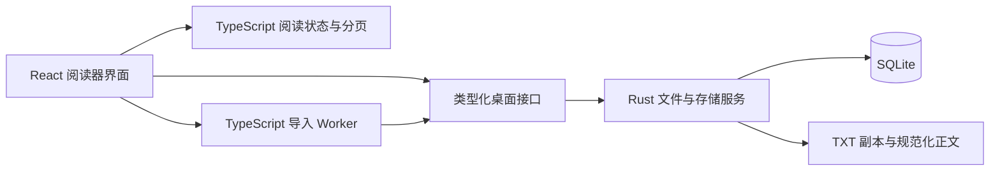

# AsterinBook 首版设计方案

日期：2026-10-08
状态：供用户审阅；当前 Demo 已确认作为界面基准，正式应用尚未开始开发。

## 1. 目标与范围

做一个在当前 Windows 电脑上使用的轻量小说阅读器：导入中文网文 TXT，放入书架管理，打开后在纸张质感的界面中按页阅读。阅读过程离线完成，书籍、进度、书签和阅读偏好保存在本地。

交付形式是 Windows 安装程序 `AsterinBook-setup.exe`。安装时选择程序位置，首次启动时单独选择阅读数据位置；以后可以在设置中迁移阅读数据。

### 已确认的需求

| 项目 | 首版行为 |
| --- | --- |
| 平台 | 当前 Windows，最终打包为安装版 EXE |
| 开发方向 | TypeScript 为主，桌面能力采用 Tauri + 少量 Rust |
| 两个目录 | 程序安装目录、阅读数据目录分别自定义 |
| TXT 导入 | 复制原文件到阅读数据目录，不依赖原文件路径 |
| 小说类型 | 优先中文网文，自动识别章节 |
| 书架 | 管理多本小说，各自保存阅读位置和书签 |
| 阅读布局 | 点击书籍后，阅读界面填满整个应用窗口 |
| 翻页 | 一屏一页；点击、方向键、滚轮上下翻页 |
| 章节边界 | 翻页到章节首尾时停留，不自动跨章 |
| 常用功能 | 目录跳转、书签、续读、字号及阅读样式调整 |
| 视觉 | 当前 Demo 的纸张颜色、书本质感和克制的工具栏 |
| 正文搜索 | 首版不做正文关键词搜索 |

### 本方案建议的默认选择

以下是实现方案，不是新增的用户要求：React + Vite、SQLite、单实例运行、50 MiB 的单文件导入上限、书架按最近阅读排序、字体优先使用系统已有中文字体。开发时以这些默认值推进，用户可以在审阅时调整。

首版不加入在线书源、账号、云同步、自动更新、EPUB/PDF、朗读、批注、自动翻页、复杂分类标签、在线封面下载和章节规则编辑器。中文章节识别是首版能力，多语言排版和其他文件格式以后再扩展。

## 2. 界面基准与页面

界面以 [当前 Demo](../../../demo/index.html) 和 [铺满窗口的阅读页截图](../../../demo/reader-full-page.jpg) 为基准。保留颜色、排版、封面形式、工具栏位置和交互方向，正式应用拆成 TypeScript 组件，不继续把全部逻辑堆在单个 HTML 文件中。

Demo 中的示例书籍、导入和路径选择有模拟行为；方案要求将这些替换为真实本地文件操作和持久化。截图确认的是视觉与布局，不能代替真实桌面程序的验收。

### 2.1 首次启动

1. 显示推荐的阅读数据目录和“选择文件夹”。
2. 用户选择后，检查可写权限，展示实际使用路径。
3. 空目录：初始化书库；已有 AsterinBook 数据：校验后打开原书库。
4. 非空且不是 AsterinBook 数据目录：提示选择其他目录，不覆盖已有文件。
5. 初始化成功后进入书架。

建议使用本机可写目录。阅读数据目录与程序安装目录分离，避免升级或卸载影响书库；不要将数据放在安装目录及其子目录中。

### 2.2 书架

- 沿用 Demo 的书架卡片和左侧导航，展示书名、最近阅读信息和阅读进度。
- 书名默认取 TXT 文件名；作者未知时留空，不根据文件内容猜测作者。
- 用书名和配色生成封面，不依赖外部图片服务。
- 点击一本书：恢复其阅读位置；首次打开：进入第一个章节。
- 提供 TXT 导入、书名修改、移除书籍，以及最近阅读/书名排序。
- 移除前说明会删除该书的本地副本、进度和书签；确认后执行，不影响用户原始 TXT。
- 空书架提供明显的导入入口；导入中显示进度，失败显示原因且允许重试。

### 2.3 阅读页

**阅读页占满应用窗口，不保留书架侧栏和书架顶部栏，也不把正文放在居中的小卡片里。** 这是应用窗口内的布局；首版不需要强制进入操作系统全屏。

- 顶部保留轻量工具栏：返回书架、书名/章节、目录、书签、阅读设置。
- 中间纸张区域使用剩余高度，保持单页正文，正文不出现自由滚动条。
- 底部显示本章页码、阅读进度、翻页和显式切换章节入口。
- 纸张背景铺满阅读区域；正文仍保留舒适的内边距和可调整的行宽，避免宽屏文字贴边。
- 一屏只展示一页，不采用左右两页的双页书本布局。
- 在较宽窗口，目录、书签、设置面板占用侧边空间，正文重新分页；较窄窗口使用覆盖面板，面板可独立滚动。
- 切换主题保留 Demo 的纸张色系与轻微纹理，文字对比度优先于装饰效果。

### 2.4 设置

阅读设置包含字号、字体、行距、页边距、纸张主题，默认作为全局偏好保存。字体列出可用系统字体及可靠的回退字体；首版不打包额外的大字体文件。

应用设置显示当前阅读数据路径，提供“更改阅读数据目录”。目录变更按第 7 节执行迁移，不能仅修改一个路径字符串。

## 3. 阅读交互规则

### 3.1 翻页与切章

| 操作 | 行为 |
| --- | --- |
| 点击正文左侧区域 | 上一页 |
| 点击正文右侧区域 | 下一页 |
| ← / ↑ | 上一页 |
| → / ↓ | 下一页 |
| 滚轮向上 | 上一页 |
| 滚轮向下 | 下一页 |
| 上一章 / 下一章按钮 | 显式切换章节，进入目标章节第一页 |
| 点击目录章节 | 跳到该章第一页 |
| 点击书签 | 跳到书签所在章节及包含该位置的页面 |

正文左右外侧各约四分之一宽度作为点击翻页区，中间区域允许选择文字。选择文字时不触发翻页。输入框获得焦点、输入法组合输入期间，以及操作面板时，不拦截相关键盘或滚轮操作。

**章节第一页向前翻、章节最后一页向后翻，都停留在原页。** 翻页按钮显示边界状态；点击、键盘、滚轮共用这一规则。必要时显示短暂提示“已到本章末尾，请选择下一章”，不弹出强制确认框。

滚轮按一次手势触发一页，过滤触控板惯性和短时间重复事件。持续操作需要明确的新一轮手势；具体阈值在当前电脑实际体验后调整。

### 3.2 页码、进度和书签

- 页码表示“当前章节第几页 / 当前章节总页数”，随窗口和排版设置变化。
- 全书进度按规范化正文的逻辑位置估算，不预先计算全书页数。
- 自动续读和书签保存的是正文位置，不是页码。
- 添加书签记录当前页起始正文位置、章节和短摘录；当前位置已有书签时可取消，书签列表可跳转和删除。
- 每本书有独立的进度；最后一章最后一页可显示“全书末尾”，翻页仍停留。

### 3.3 重新排版

改变字号、字体、行距、边距、窗口大小，或打开侧面板时，重新计算分页，并展示包含原阅读位置的页面。

重新排版本身不改变保存的逻辑锚点，避免连续缩放导致阅读位置逐步漂移。只有主动翻页、切章或跳书签等阅读操作才更新锚点。字体加载完成后再测量排版；过期的分页任务不得覆盖最新结果。

## 4. 技术方案

### 4.1 推荐组合

| 层 | 技术 | 职责 |
| --- | --- | --- |
| 界面 | React + TypeScript | 书架、阅读页、面板、设置和状态协调 |
| 前端构建 | Vite | 开发预览、类型化项目结构、生产静态资源构建 |
| 桌面壳 | Tauri 2 | Windows 窗口、系统文件选择、前后端桥接、打包 |
| 本地能力 | Rust | 文件复制、数据目录、数据库、导入落盘和目录迁移 |
| 数据库 | SQLite，Rust `rusqlite` | 书籍元数据、章节索引、进度、书签、偏好 |
| 重计算 | TypeScript Web Worker | 编码处理、规范化、章节扫描，减轻界面线程负担 |
| 分页 | DOM 测量 + TypeScript | 根据真实字体与可用尺寸生成页边界 |

Tauri 使用 Windows WebView2 展示前端；安装后的程序不需要启动 Vite 或本地 HTTP 服务。Tauri 官方支持 NSIS `setup.exe` 安装包，适合本项目的安装版交付。[Tauri Windows 安装文档](https://v2.tauri.app/distribute/windows-installer/)

数据库由 Rust 打开用户选择目录中的具体文件路径，使用 `rusqlite` 的 bundled SQLite，避免另行安装数据库，也避免把数据库路径绑定在默认应用数据目录。[rusqlite 文档](https://docs.rs/crate/rusqlite/latest)

### 4.2 选择理由与取舍

| 方案 | 优点 | 本项目的取舍 |
| --- | --- | --- |
| Tauri + TypeScript | 利用系统 WebView2，桌面壳适合控制安装体积 | 推荐；需要少量 Rust 和 Windows C++ 构建工具 |
| Electron + TypeScript | JavaScript 生态完整，桌面接口成熟 | 自带 Chromium 与 Node，通常体积和基础内存开销更高 |
| 纯网页 / PWA | 开发简单 | 自定义本地数据目录、迁移及安装 EXE 不符合本次交付方向 |

目前已验证 Node、Rust/Cargo 和 MSVC 工具链可用，最小 Rust 程序已经编译运行；正式 Tauri 项目的构建、安装包大小和内存占用仍需在实现时实测，不预先承诺数值。

### 4.3 模块边界



TypeScript 负责主要产品逻辑。Rust 的职责集中在真实文件操作和持久化，通过有限的类型化接口提供服务；界面不直接执行任意文件路径读写。文件路径由原生选择器或已登记的数据目录产生，书籍文件操作使用书籍 ID。

建议目录结构：

```text
src/
  app/                    应用入口、页面与启动状态
  features/library/       书架与书籍管理
  features/reader/        阅读页、目录、书签、阅读设置
  features/settings/      数据目录设置
  domain/                 章节、逻辑位置、分页模型
  workers/                TXT 编码与章节解析
  bridge/                 原生接口及共享类型
  styles/                 Demo 的颜色、纸张和排版变量
src-tauri/src/
  commands/               对前端暴露的接口
  services/               导入、数据目录、迁移和恢复
  storage/                SQLite、版本迁移、文件存储
```

## 5. TXT 导入与章节识别

### 5.1 导入流程

1. 原生文件选择器选取 TXT，检查文件大小和可读性。
2. Rust 将原文件复制到导入暂存区，生成书籍 ID 和原文件 SHA-256。
3. 若同一原文件已经导入，定位已有书籍，避免重复副本。
4. 使用二进制传输给 Worker 做解码、预览、规范化和章节扫描，避免大文本经 JSON 反复复制。
5. 用户确认编码预览后，生成 UTF-8 规范化正文与章节索引。
6. Rust 校验索引范围，保存正文，事务写入书籍和章节信息；完成后才在书架显示为可阅读。
7. 失败时保留原书库可用，清理或恢复本次暂存任务，不留下表面成功但不能打开的书籍。

建议首版单文件上限为 50 MiB，超出时在复制前提示。导入使用 Worker 和进度反馈，避免阻塞界面；内存和耗时需要用真实大文件验证。原始副本和规范化正文同时保存，磁盘空间检查必须考虑两份内容及暂存空间。

### 5.2 编码与正文规范化

- 优先识别 BOM：UTF-8、UTF-16 LE/BE。
- 无 BOM 时先严格尝试 UTF-8；不符合时尝试 GB18030，覆盖常见 GBK 中文网文。
- 自动选择不可靠时展示短正文预览，允许手动选择 UTF-8、GBK/GB18030、UTF-16 LE/BE 后重试。
- 严格解码只能发现非法字节，不能证明编码选择正确；不能把“没有报错”等同于“没有乱码”。
- 规范化只处理 BOM 和换行符，将 CRLF/CR 统一为 LF；保留正文与段落，不自动删广告、不繁简转换。

上述编码可使用浏览器 `TextDecoder`；中文编码映射按 Encoding Standard 实现。[编码标准](https://encoding.spec.whatwg.org/)

### 5.3 章节规则

以独立行作为候选标题，支持常见形式：

```text
第一章 雨夜来客
第12章 新的旅程
第１２章 新的旅程
第两百零一章 山门
第三回 故人重逢
第十节 灯火
```

采用保守规则：限制标题行长度，支持中文、阿拉伯及全角数字，优先匹配“第…章/回/节”。“第…卷/部”作为层级标题；序章、楔子、尾声、后记等仅在独立短行中识别，并结合上下文避免误切正文。

首个章节前的文字作为“序言”；没有识别出章节时整本作为“正文”，仍可以完整阅读。识别出的章节标题单独显示，正文不再次重复标题。原始文本完整保留，识别不佳时可以提示用户，但首版不加入手工目录编辑器。

正文位置统一使用**规范化文本中的 UTF-16 全局偏移**，与 TypeScript 字符串索引一致；同时记录每章正文的 UTF-8 字节范围，便于 Rust 只读取目标章节。章节索引标明标题和正文起点，所有范围采用左闭右开，避免边界重复。

## 6. 分页与持久化

### 6.1 分页方式

读取当前章节后，根据正文区域的真实宽高、字体、字号、行距和边距测量分页。正文按段落处理，超长段落继续拆分；切分不能破坏代理对、组合字符或 emoji。中文行首行尾标点按浏览器中文排版规则处理，并验证页边界。

页面只渲染当前页及必要的测量内容，不将整本小说插入 DOM。章节正文按需读取，使用有容量限制的缓存；超长单章分块处理。页边界缓存与章节内容版本、排版参数、字体和窗口尺寸绑定，参数变化时重新计算。

先计算足够展示当前阅读位置的页面，再完成本章其余分页；未完成时明确显示正在排版，不能用旧总页数冒充新结果。分页过程中保留原阅读锚点，新的任务可以取消旧任务。

### 6.2 数据目录

```text
用户选择的阅读数据目录/
  library.json                  书库标识与存储格式版本
  reader.db                     SQLite 数据库
  books/
    <book-id>/
      source.txt                导入原文件的逐字节副本
      content.txt               规范化 UTF-8 正文
  staging/                      未完成导入与恢复标记
```

数据库记录相对路径，不把当前数据目录的绝对路径写入每条书籍记录。小说正文存文件，数据库保存索引及小型结构化信息。

系统默认用户应用数据目录只保存一份小型 `bootstrap.json`，记录当前阅读数据目录和迁移状态，以便下次启动找到书库。书籍、进度、书签和阅读偏好都放在用户选择的数据目录。WebView2 自身的缓存等运行文件另由桌面运行时管理。

### 6.3 核心数据

| 表 | 主要字段与作用 |
| --- | --- |
| books | ID、书名、可空作者、原文件名、哈希、编码、内容版本、导入时间、最近阅读时间、导入/删除状态 |
| chapters | 书籍 ID、顺序、标题、层级、标题及正文逻辑位置、正文 UTF-8 字节范围 |
| reading_positions | 书籍 ID、正文逻辑偏移、更新时间；每书一条 |
| bookmarks | ID、书籍 ID、逻辑偏移、摘录、创建时间；章节由索引定位 |
| preferences | 主题、字号、字体、行距、边距、书架排序 |

数据库启用外键，相关修改使用事务，架构升级使用明确版本迁移。Rust 统一串行协调数据库写入，把文件和数据库操作放到非界面线程；首版使用便于关闭后迁移的 SQLite 日志模式，不在数据库运行时直接复制数据库文件。

翻页后的进度在约 1 秒内合并保存，切书、返回书架、正常退出时刷新待保存进度；书签和设置写入成功后才显示操作成功。异常断电允许损失最后约 1 秒的进度，但不应留下已确认书签的一半记录或不可打开的书库。

导入采用暂存标记、文件提交和数据库事务协调；启动时核对未完成任务，恢复或清理孤立文件。删除书籍同样记录任务状态，失败后可重试，不误删其他书籍。

## 7. 更改阅读数据目录

这是“迁移书库”，不是更改以后导入文件的路径。

1. 用户选择目标目录，展示来源、目标和将迁移的数据量。
2. 校验目标可写、空间充足，不是当前目录或其父子目录；目标须为空，或者选择打开已有有效书库。
3. 暂停导入与阅读操作，刷新进度并关闭数据库连接。
4. 将书库复制到目标侧的暂存目录，逐个校验内容哈希，并校验 SQLite 完整性。
5. 校验通过后提交目标目录，再原子更新启动路径记录。
6. 打开目标书库，恢复当前书籍和位置；失败则返回原书库。
7. 成功后保留原书库副本，说明可在确认新目录正常后手动清理，不自动删除原目录。

目标已有有效 AsterinBook 书库时，提供“打开此书库”；首版不自动合并两个书库。目录迁移的暂存、提交与启动路径切换要有可恢复的状态记录，不能在中途失败时悄悄初始化空书架。

启动时数据目录丢失、断开或只读，明确提示重试或重新选择。不能把访问失败当成“没有书”，也不能覆盖已有数据。

应用采用单实例运行，避免两个进程同时迁移或写入同一书库。[Tauri 单实例插件](https://v2.tauri.app/plugin/single-instance/)

## 8. Windows 安装与打包

- 使用 Tauri 的 NSIS 安装包，默认当前用户安装，中文安装界面。
- 安装程序提供目录选择页，允许选择程序安装位置；以实际安装测试确认该页面和升级行为，必要时调整 NSIS 模板或钩子。
- 首次启动再选择阅读数据位置，安装器不替用户固定书库路径。
- 优先使用当前电脑已有 WebView2；缺失时由安装程序处理运行时安装。缺失运行时的在线安装可能需要网络，阅读小说本身不需要网络。
- 升级保留书库和启动路径；卸载默认保留阅读数据和定位书库所需的小型启动记录，重新安装后可恢复。
- 产物包括应用可执行文件和安装 EXE；正式交付以安装 EXE 为准，首版不另做便携版。

构建成功不等于安装成功。必须在当前 Windows 上实际安装、启动、读写数据、升级和卸载验证。安装包体积、启动耗时、常驻内存以这一阶段的实测结果为准。

## 9. 实施顺序

以下是阶段划分，详细到文件与任务的实施计划在方案审阅后另行编写。

| 阶段 | 产出 | 阶段完成条件 |
| --- | --- | --- |
| 1. 桌面基础 | React/TypeScript/Tauri 工程，Demo 样式迁移，首次启动与数据目录 | 真实 Windows 窗口可启动，目录可初始化并再次打开 |
| 2. 真实书库 | TXT 复制、编码预览、章节解析、书架与数据库 | 导入真实小说后，退出重开仍能正常打开；原 TXT 可移走 |
| 3. 阅读核心 | 铺满窗口、分页、点击/键盘/滚轮、目录与逻辑位置 | 各种翻页方式遵守章节边界，排版变化不丢阅读位置 |
| 4. 阅读数据完整性 | 书签、偏好、目录迁移、异常恢复 | 书签和设置可靠保存，迁移失败可回到原书库 |
| 5. EXE 交付 | NSIS 安装包与真实安装验证 | 自定义两个目录、升级和卸载行为通过验收 |

优先完成可实际使用的纵向链路：导入一本 TXT → 解析章节 → 阅读 → 保存进度 → 重开续读，再补齐其他界面与错误状态。

## 10. 验收标准

### 功能与体验

- 至少两本小说可同时管理，各自的进度、目录和书签互不串用。
- 导入后移动或删除原 TXT，书库中的副本仍可阅读；重复导入同一个原文件不会无提示生成重复书籍。
- UTF-8、带 BOM 的 UTF-16、GBK/GB18030 样例正常显示；可通过预览纠正不可靠的编码选择。
- 覆盖中文数字章节、数字章节、卷标题、序言、无章节文本和正文中出现“第…章”的情况，正文不丢失、不误切常见段落。
- 阅读页在当前电脑常用窗口尺寸下填满窗口，无书架残留、横向溢出和正文自由滚动；面板可单独滚动。
- 点击、四个方向键和滚轮都可以翻页；选字、输入和面板操作不会误翻。
- 章节末尾向后翻、章节开头向前翻均停留；只有目录或显式切章控件可以跨章。
- 调整字号、字体、行距、边距，反复改变窗口尺寸，仍停留在包含原逻辑锚点的页面。
- 长段落、中文标点、emoji 的分页没有遗漏、重复或破损；正文字符覆盖可自动核对。
- 退出重开恢复书籍位置、书签和偏好；首版没有正文关键词搜索入口。

### 数据与安装

- 程序安装目录和阅读数据目录可分别选择，支持中文、空格及非 C 盘路径。
- 迁移后书籍、进度、书签和偏好一致；模拟空间不足、复制中断、路径切换前后退出，仍能打开一份完整书库。
- 无法访问数据目录时给出明确错误，不静默生成新书库。
- 用接近导入上限的 TXT 验证界面响应和内存，不因整本 DOM 或整本 JSON 传输造成不可用。
- 安装 EXE 真正安装后可离线阅读；升级和卸载不删除阅读数据。

章节解析、逻辑位置和存储恢复规则使用针对性自动测试；分页与界面做真实浏览器检查；文件选择、数据目录、进程退出和安装包必须做原生桌面验证。Demo 演示不能替代后两类验证。

## 11. 本次产出与下一步

本次产出是这份设计方案，确认产品边界、页面规则、技术职责和交付验收。当前 Demo 保留作为视觉参照。

用户审阅这份方案后，再编写具体实施计划；正式开发以方案和实施计划为依据。编码识别、超长单章分页、目录迁移恢复和安装器目录选择是实现时优先验证的关键点。
